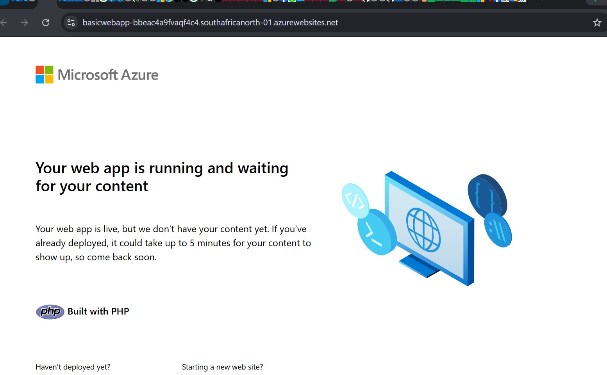
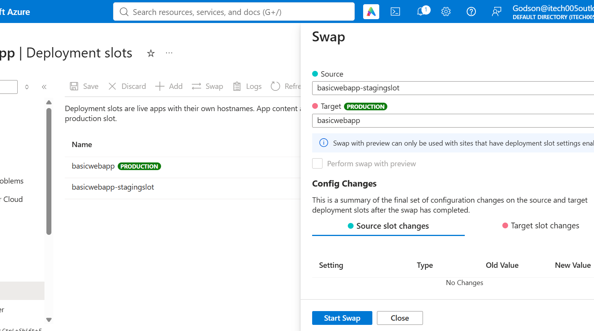

# Azure App Service CI/CD Automation Using GitHub Actions

**Technologies:** Microsoft Azure | GitHub Actions | Azure App Service | Microsoft Entra ID | HTML | CSS | JavaScript | YAML | Visual Studio Code

## Introduction

This project demonstrates the implementation of an automated Continuous Integration and Continuous Deployment (CI/CD) pipeline using GitHub Actions to deploy a web application to Microsoft Azure App Service.

The project involved developing a basic website using HTML, CSS and JavaScript, hosting the source code on GitHub, configuring Azure App Service with a staging deployment slot, and implementing GitHub Actions workflows to automate website validation and deployment.

Secure authentication between GitHub Actions and Microsoft Azure was configured using Microsoft Entra ID application registration and federated credentials, eliminating the need to store Azure client secrets for authentication.

The deployment process was designed to validate application files, package the website as an artifact, and deploy the application to the Azure App Service staging slot.

The project also involved troubleshooting deployment failures, correcting configuration errors, and verifying the successful deployment of the application.

## Project Preview

The following screenshot shows the successfully
deployed website hosted on Azure App Service deployed to stagingslot and then later swapped into production. The production slot is showing the default page of Microsoft Azure 

## Staging slot

## Production slot

## Swaping 

## Project Overview

This project demonstrates the implementation of a CI/CD pipeline using GitHub Actions to automate the validation and deployment of a website to Microsoft Azure App Service.

The website was developed using HTML, CSS and JavaScript in Visual Studio Code and stored in GitHub.

GitHub Actions was configured to validate application files, package the website and deploy it to an Azure App Service staging slot.

Secure authentication between GitHub and Azure was implemented using Microsoft Entra ID federated credentials.

The deployment was successfully completed after troubleshooting and correcting a configuration error.

## Project Architecture

## Project Objectives

The main objectives of this project were to:

- Develop a basic web application using HTML, CSS and JavaScript.
- Manage application source code using Git and GitHub.
- Implement automated website validation using GitHub Actions.
- Create a reusable CI/CD workflow for application deployment.
- Configure secure GitHub-to-Azure authentication using Microsoft Entra ID federated credentials.
- Deploy the application to Azure App Service using a staging deployment slot.
- Troubleshoot deployment errors and verify successful application deployment.
-
