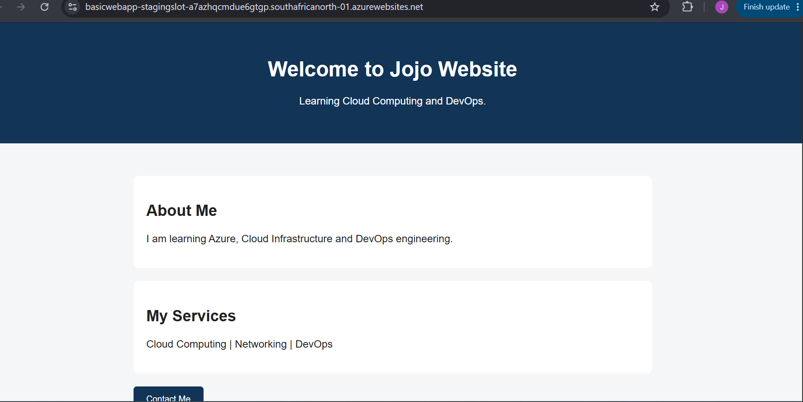
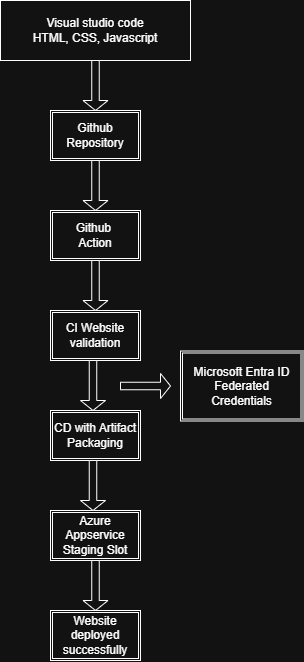
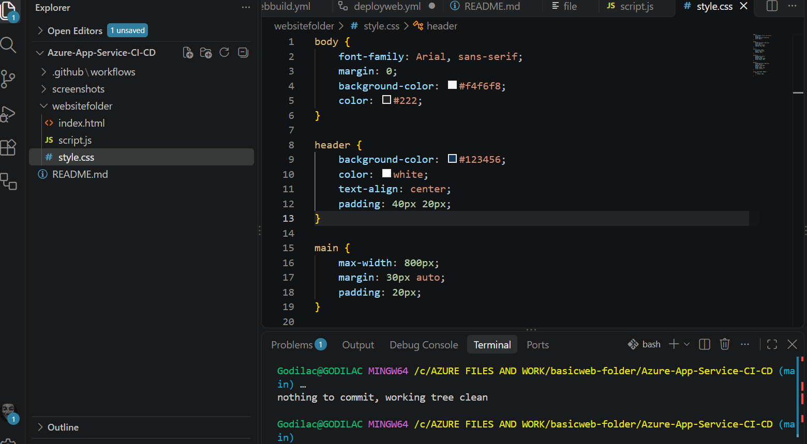
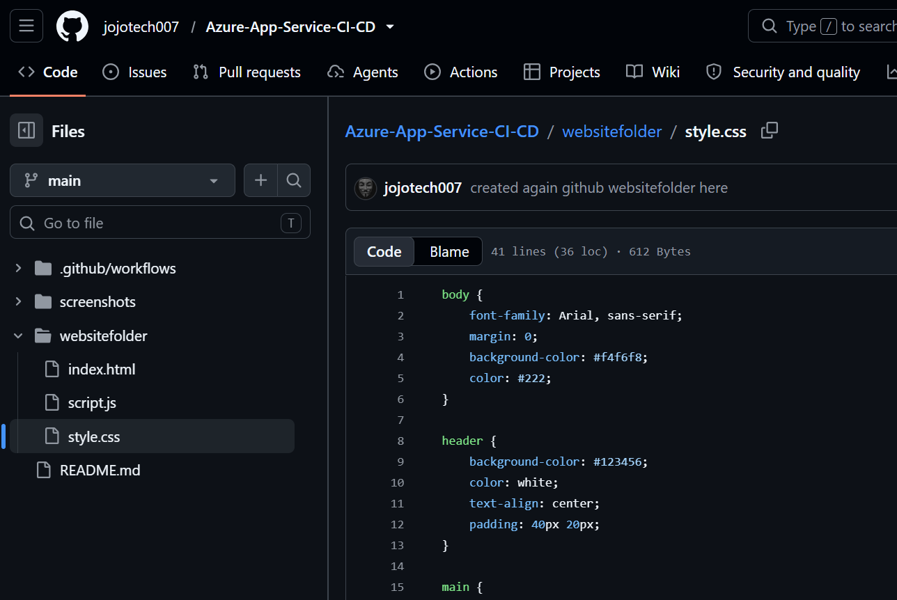

# Azure App Service CI/CD Automation Using GitHub Actions

**Technologies:** Microsoft Azure | GitHub Actions | Azure App Service | Microsoft Entra ID | HTML | CSS | JavaScript | YAML | Visual Studio Code

## Introduction

This project demonstrates the implementation of an automated CI/CD solution for deploying a web application to Microsoft Azure App Service using GitHub Actions.

It showcases practical cloud engineering skills in application deployment, workflow automation, secure authentication and deployment troubleshooting.

## Project Preview

The following screenshot shows the successfully
deployed website hosted on Azure App Service

## Project Overview And Architecture

The solution uses GitHub Actions to automate the validation and deployment of a website hosted on Azure App Service.

The workflow follows this process:

1. Website source code is maintained in GitHub.
2. GitHub Actions validates essential application files.
3. The website is packaged and uploaded as a workflow artifact.
4. The deployment workflow downloads the artifact.
5. GitHub Actions authenticates with Azure using Microsoft Entra ID federated credentials.
6. The website is deployed to the Azure App Service staging slot for verification.

The application is hosted on an Azure Web App named `basicwebapp`.

## Architecture

## Project Objectives

The main objectives of this project were to:

- Develop a basic web application using HTML, CSS and JavaScript.
- Manage application source code using Git and GitHub.
- Implement automated website validation using GitHub Actions.
- Create a reusable CI/CD workflow for application deployment.
- Configure secure GitHub-to-Azure authentication using Microsoft Entra ID federated credentials.
- Deploy the application to Azure App Service using a staging deployment slot.
- Troubleshoot deployment errors and verify successful application deployment.

## Tools and Technologies

| Tool / Technology | Purpose |
|---|---|
| Visual Studio Code | Website development and YAML editing |
| HTML, CSS and JavaScript | Website development |
| Git | Source code version control |
| GitHub | Source code hosting and repository management |
| GitHub Actions | CI/CD workflow automation |
| YAML | Defining automated workflow configurations |
| Microsoft Azure | Cloud hosting platform |
| Azure App Service | Hosting the web application |
| Azure Deployment Slots | Providing a staging environment |
| Microsoft Entra ID | Application registration and federated authentication |
| OpenID Connect (OIDC) | Secure authentication between GitHub Actions and Azure |

## Project Implementation

### 1. Website Development

The website was developed using Visual Studio Code with HTML, CSS and JavaScript.

The application files were organized into a project folder and prepared for source control using Git.

### GitHub Repository Setup

A GitHub repository was created to host the website source code.

Git was used to push the local project files from Visual Studio Code to GitHub, providing a central location for version control and CI/CD automation.

