# Azure App Service CI/CD Automation Using GitHub Actions

**Technologies:** Microsoft Azure | GitHub Actions | Azure App Service | Microsoft Entra ID | HTML | CSS | JavaScript | YAML | Visual Studio Code

## Introduction

This project demonstrates the implementation of an automated CI/CD solution for deploying a web application to Microsoft Azure App Service using GitHub Actions.

It showcases practical cloud engineering skills in application deployment, workflow automation, secure authentication and deployment troubleshooting.

## Project Preview

The following screenshot shows the successfully
deployed website hosted on Azure App Service

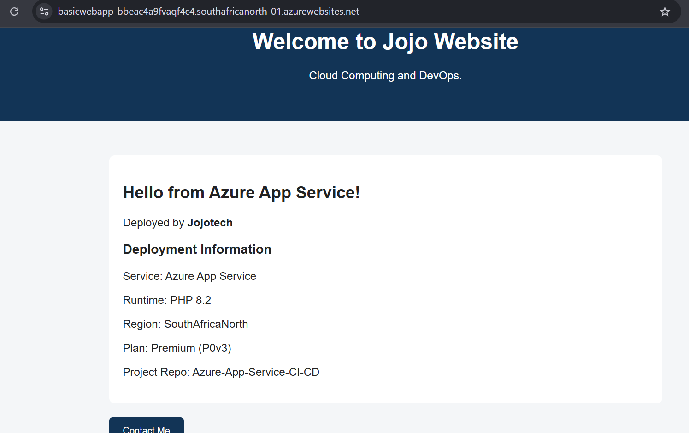


## Project Overview And Architecture

The solution uses GitHub Actions to automate the validation and deployment of a website hosted on Azure App Service.

The workflow follows this process:

1. Website source code is maintained in GitHub.
2. GitHub Actions validates essential application files.
3. The website is packaged and uploaded as a workflow artifact.
4. The deployment workflow downloads the artifact.
5. GitHub Actions authenticates with Azure using Microsoft Entra ID federated credentials.
6. The website is deployed to the Azure App Service staging slot for verification.

The application is hosted on an Azure Web App named `basicwebapp`.


## Architecture

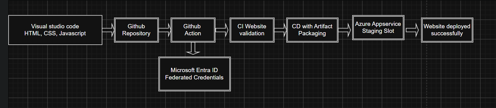


## Project Objectives

The main objectives of this project were to:

- Develop a basic web application using HTML, CSS and JavaScript.
- Manage application source code using Git and GitHub.
- Implement automated website validation using GitHub Actions.
- Create a reusable CI/CD workflow for application deployment.
- Configure secure GitHub-to-Azure authentication using Microsoft Entra ID federated credentials.
- Deploy the application to Azure App Service using a staging deployment slot.
- Troubleshoot deployment errors and verify successful application deployment.


## Tools and Technologies

| Tool / Technology | Purpose |
|---|---|
| Visual Studio Code | Website development and YAML editing |
| HTML, CSS and JavaScript | Website development |
| Git | Source code version control |
| GitHub | Source code hosting and repository management |
| GitHub Actions | CI/CD workflow automation |
| YAML | Defining automated workflow configurations |
| Microsoft Azure | Cloud hosting platform |
| Azure App Service | Hosting the web application |
| Azure Deployment Slots | Providing a staging environment |
| Microsoft Entra ID | Application registration and federated authentication |
| OpenID Connect (OIDC) | Secure authentication between GitHub Actions and Azure |


## Project Implementation

### 1. Website Development

The website was developed using Visual Studio Code with HTML, CSS and JavaScript.

The application files were organized into a project folder and prepared for source control using Git.


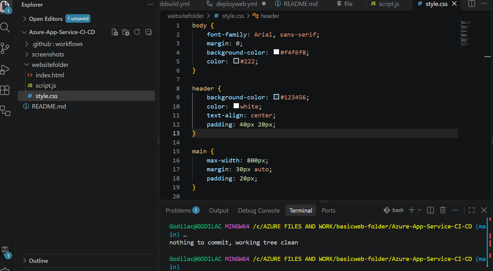


### GitHub Repository Setup

A GitHub repository was created to host the website source code.

Git was used to push the local project files from Visual Studio Code to GitHub, providing a central location for version control and CI/CD automation.


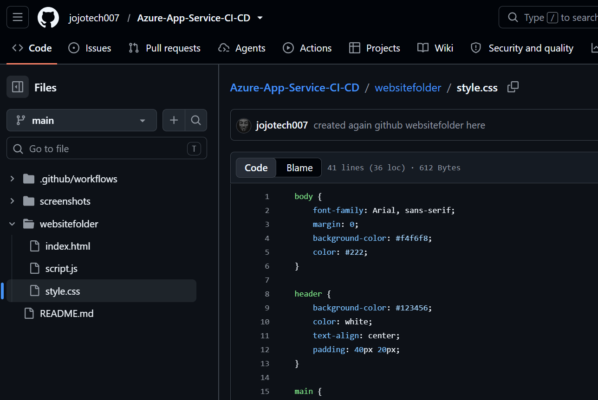


### 2. Azure App Service Configuration

An Azure App Service Web App named `basicwebapp` was created to host the website.

A staging deployment slot named `stagingslot` was also created to provide a separate environment for testing deployments before they are moved to the production slot.


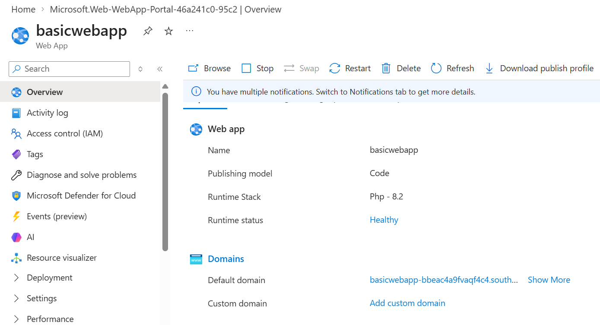


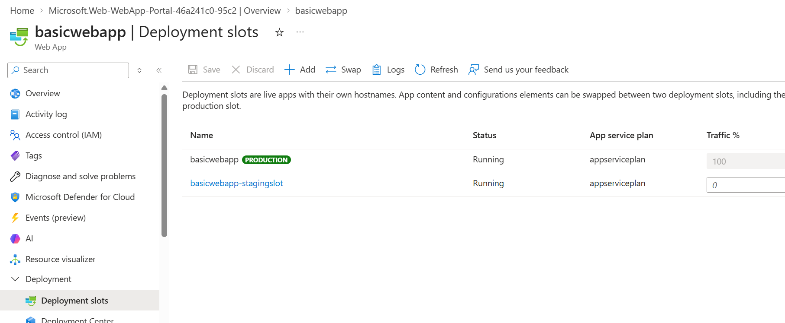


### 3. Microsoft Entra ID App Registration and Federated Credentials

An application registration was created in Microsoft Entra ID to establish a trusted identity between GitHub Actions and Azure.

Federated credentials were configured using OpenID Connect (OIDC), allowing GitHub Actions to authenticate securely with Azure without requiring a stored client secret.

The App Registration's Service Principal was assigned the **Contributor** role at the **Resource Group level**, providing the permissions required to deploy the web application to Azure App Service.

Why this matters
- Contributor: Allows the Service Principal to manage resources within its assigned scope, but not grant access to other users.
- Resource Group scope: Limits the role assignment to resources within that particular Resource Group, rather than the entire Azure subscription.


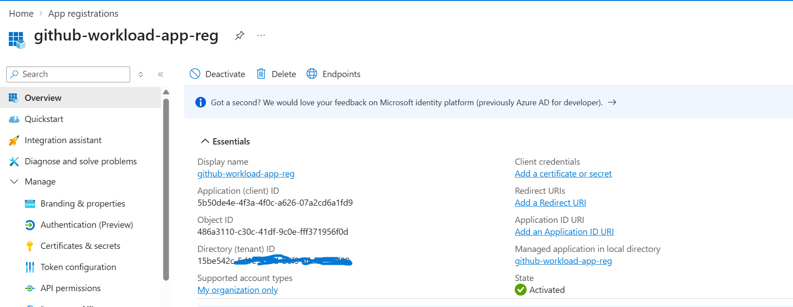


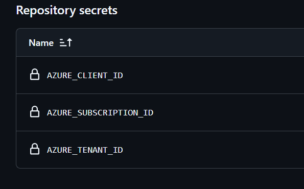


### 4. GitHub Actions CI Workflow – Website Validation

A GitHub Actions workflow was created to automate the validation of the website source files.

The workflow checks for the presence of the essential application files (`index.html`, `style.css` and `script.js`) to ensure they are available before deployment.

After successful validation, the website files are packaged and uploaded as a GitHub Actions artifact. This artifact is then made available for the deployment workflow to download and use during the Azure App Service deployment process.

This approach ensures that only validated application files proceed to the deployment stage.


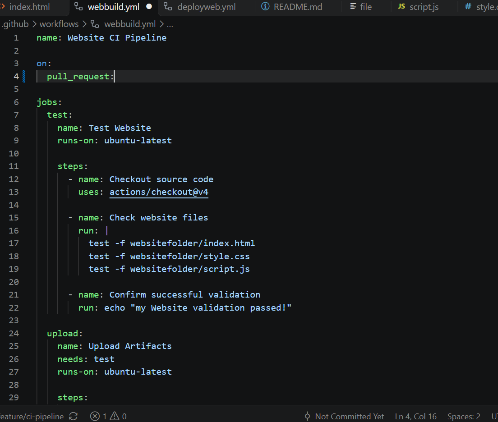


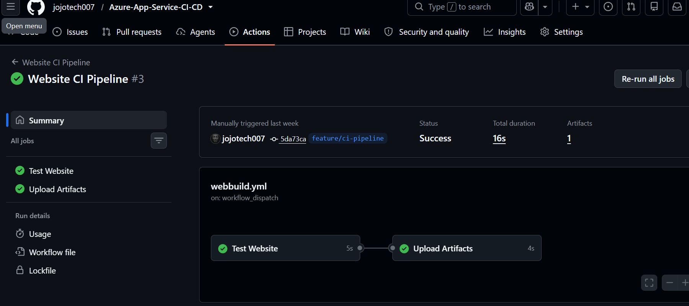


What this section demonstrates
- GitHub Actions workflow configuration using YAML.
- Automated file validation using Linux shell commands.
- Workflow execution on an Ubuntu runner.
- Early detection of missing application files
- Then packaged the website as an artifact to  be used for the deploymnet


### 5. GitHub Actions CD Workflow – Azure App Service Deployment

A separate GitHub Actions workflow was configured to automate the deployment of the website to Microsoft Azure.

The existing website validation workflow was configured as a reusable workflow using the `workflow_call` trigger. The deployment workflow invokes this reusable YAML workflow to execute the validation process before proceeding with deployment.

After successful validation, the deployment workflow downloads the generated artifact containing the packaged website files.

GitHub Actions authenticates with Azure using Microsoft Entra ID federated credentials (OIDC), eliminating the need to store Azure client secrets in GitHub.

The downloaded artifact is then deployed to the `stagingslot` deployment slot of the Azure App Service Web App named `basicwebapp`.

This approach promotes workflow reusability, reduces duplicated YAML configurations and automates the deployment process.


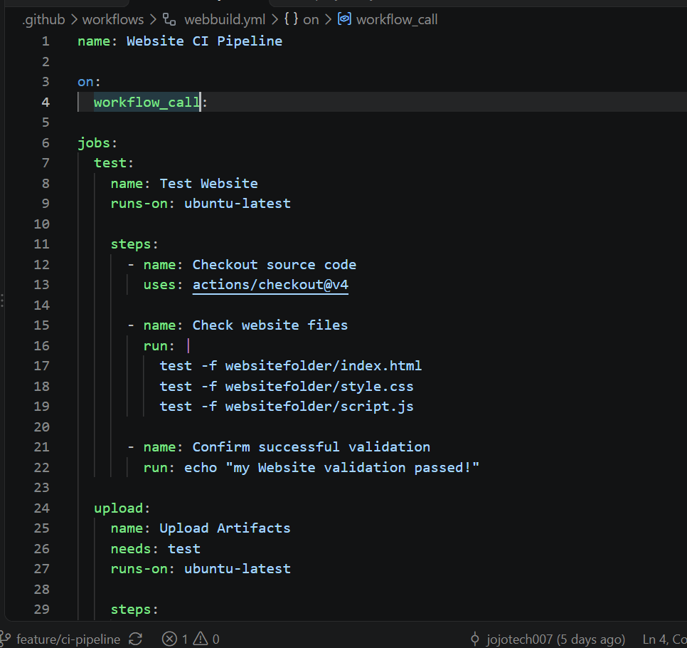


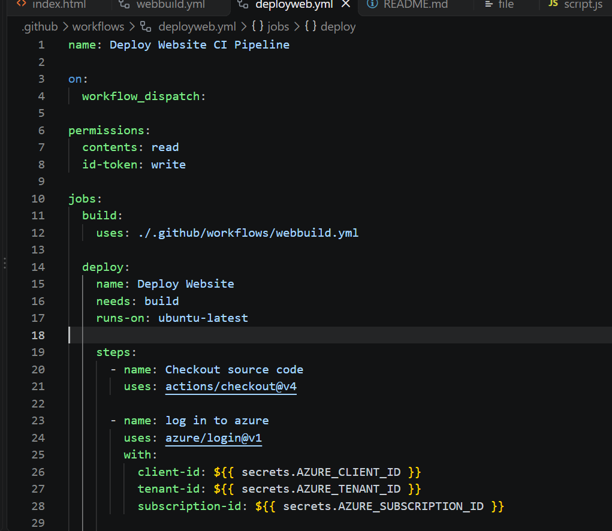


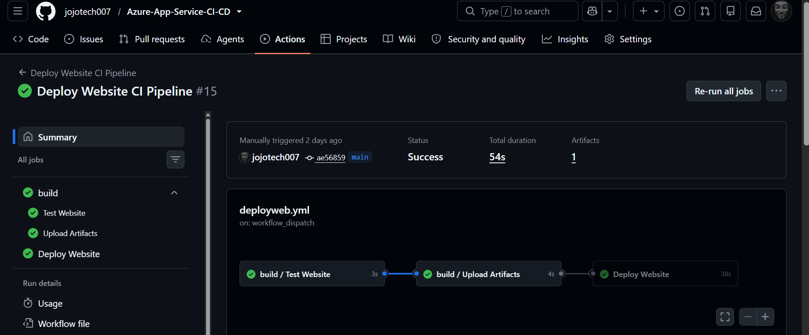


### 6. Staging Deployment Verification

After the website loaded successfully, and its content, styling and JavaScript functionality were confirmed to be working as expected, i then promoted it to the production environment by swapping it at deploymnet slot (from stagingslot-to-production)


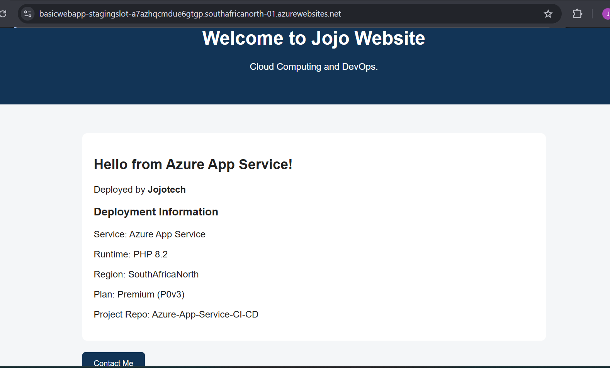


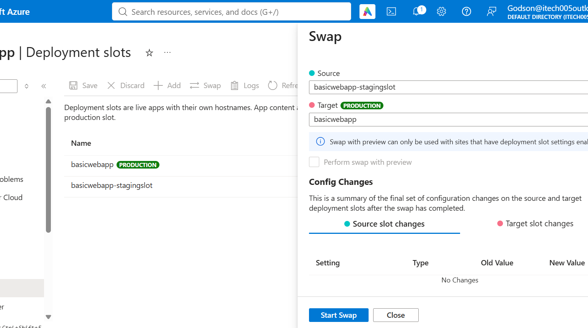


## Troubleshooting and Lessons Learned


### 1. Troubleshooting: GitHub Actions File Path Validation Failure


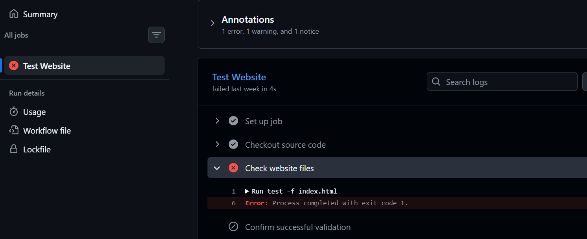


**Problem**

The GitHub Actions CI workflow failed during website file validation with the following error:

```text
test -f script.js
Error: Process completed with exit code 1.
```

**Root Cause**

The website files had been moved from the repository root (Azure-App-Service-CI-CD) into a folder named websitefolder but the validation commands still referenced the old file paths.

**Solution**

Updated the file paths in the GitHub Actions YAML workflow to match the new directory structure.

Before:
```yaml
test -f index.html
test -f style.css
test -f script.js
```

After:
```yaml
test -f websitefolder/index.html
test -f websitefolder/style.css
test -f websitefolder/script.js
```

**Validation and Artifact Creation**

After correcting the paths, the CI workflow was executed again and validation completed successfully.


**Lerson Learned**

- GitHub Actions file validation commands must accurately reflect the repository directory structure
- Linux exit codes help identify successful and failed commands
- Understanding workflow logs, Linux exit codes is essential for effective CI/CD troubleshooting


### 2. Troubleshooting: Azure Federated Identity Authentication Failure


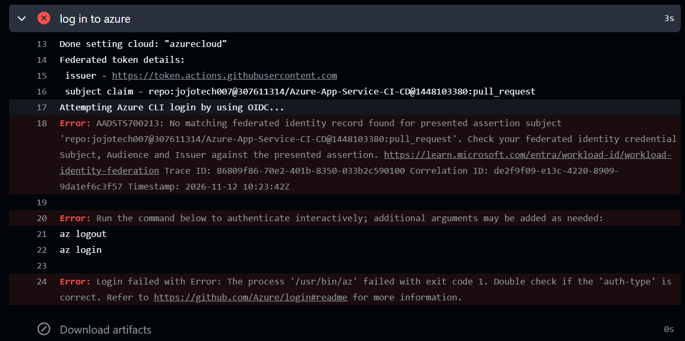


**Problem**

The GitHub Actions deployment workflow failed during Azure login with:

```text
AADSTS700213: No matching federated identity record found
```

The presented GitHub OIDC subject ended in `:pull_request`, which did not match the subject configured in Microsoft Entra ID.

**Root Cause**

The deployment workflow was triggered by a Pull Request, while the Azure Federated Identity Credential was configured to trust the `main` branch. GitHub Actions generates different OIDC subject claims depending on the triggering event.

**Resolution**

- Separated Pull Request validation from Azure deployment.
- Kept the CI workflow responsible for website validation.
- Configured the CD workflow to run manually from the `main` branch.
- Ensured the Azure Federated Credential matched the GitHub OIDC subject for the deployment context.
- Reran the deployment successfully.

**Workflow Design**

| Workflow | Trigger | Responsibility |
|---|---|---|
| CI | `pull_request` targeting main | Validate website files |
| CD | `workflow_dispatch` | Authenticate with Azure and deploy to the staging slot |

### **Lessons Learned**

- GitHub Actions uses different identity information depending on how a workflow is triggered, such as a Pull Request or a push to the `main` branch.
- The identity details sent by GitHub must match what Microsoft Entra ID is configured to trust.
- CI should focus on checking the website, while CD should handle deploying it to Azure.
- Using OIDC allows GitHub Actions to securely log in to Azure without storing permanent passwords or secret credentials.
- Separating CI validation from CD deployment ensures that only approved code from main is deployed to Azure.
